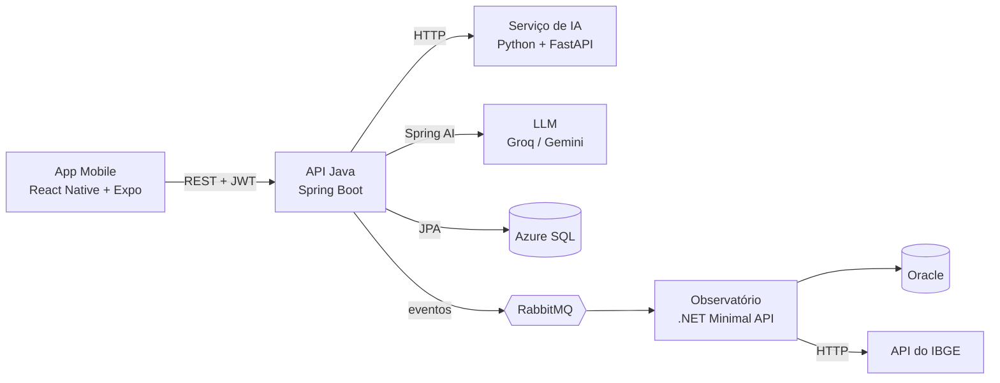

# Valence

**Rede pública e colaborativa de vigilância fitossanitária para pequenos produtores**

---

## O problema

Comunidades rurais isoladas descobrem pragas tarde, sem técnico por perto e sem um canal rápido entre vizinhos e poder público. A FAO estima que cerca de **40% da produção agrícola mundial** se perde para pragas. Só a cigarrinha-do-milho causa prejuízo estimado de **US$ 6,5 bilhões por ano** no Brasil (Embrapa, 2026). A perda chega ao produtor e também ao consumidor, no preço e na oferta.

## Como o Valence funciona

1. **Registro.** O produtor fotografa a folha danificada e descreve o problema pelo app.
2. **Triagem.** A IA analisa a imagem, consulta fichas técnicas e sugere hipóteses de praga, severidade e cuidados imediatos. É triagem, não diagnóstico.
3. **Alerta.** Propriedades vizinhas com a mesma cultura, num raio de 10 km, recebem um alerta de suspeita.
4. **Laudo.** Um agrônomo confirma ou descarta o caso. Só ele transforma a suspeita em foco confirmado.
5. **Dados abertos.** Os focos viram dados anonimizados no Observatório Fitossanitário, abertos ao poder público e a qualquer cidadão.

Além disso, o **mural da região** permite que produtores conversem sobre a situação local, com denúncias analisadas por IA e moderação humana.

> Apps de diagnóstico olham para uma lavoura de cada vez. O Valence é **coletivo**: tem validação humana e gera dado para política pública.

## Arquitetura

**Princípios**

- O app conversa só com a API Java.
- Java e .NET se integram apenas por eventos. Se o Observatório estiver fora do ar, as mensagens esperam na fila.
- A API continua funcionando sem a IA: o caso vai direto para a fila do agrônomo.
- Nenhum dado pessoal sai da API Java. Eventos e prompts levam só dados anonimizados.
- A IA nunca decide sozinha: todo alerta automático é suspeita, e só a moderação humana remove um post.

## Repositórios

| Repositório | O que é | Disciplina |
| --- | --- | --- |
| [valence-java](https://github.com/Valence-Team/valence-java) | API núcleo: ocorrências, triagem com Spring AI, alertas, laudos e mural | Java Advanced · DevOps |
| [valence-mobile](https://github.com/Valence-Team/valence-mobile) | App para produtores, agrônomos e gestores | Mobile Application Development |
| [valence-iot](https://github.com/Valence-Team/valence-iot) | Serviço de IA: visão computacional e RAG sobre fichas técnicas | Disruptive Architectures |
| [valence-dotnet](https://github.com/Valence-Team/valence-dotnet) | Observatório Fitossanitário com dados abertos e boletins | .NET |
| [valence-database](https://github.com/Valence-Team/valence-database) | Regras em Oracle PL/SQL e transição para MongoDB | Banco de Dados |
| [valence-qa](https://github.com/Valence-Team/valence-qa) | Backlog Scrum e casos de teste funcionais | Compliance, QA & Tests |

O CI/CD da API (pipeline YAML, scripts Azure CLI e Dockerfile) fica no `valence-java`, espelho público do repositório no Azure Repos.

## Tecnologias

## Impacto

| ODS | Contribuição |
| --- | --- |
| 2 · Fome zero e agricultura sustentável | Reduz perdas de safra com detecção precoce |
| 9 · Indústria, inovação e infraestrutura | Leva IA e dados ao campo com baixo custo |
| 10 · Redução das desigualdades | Dá ao pequeno produtor isolado acesso a um técnico |
| 13 · Ação contra a mudança do clima | Monitora pragas que se espalham com o clima |

## Equipe

| Integrante | RM | Frentes |
| --- | --- | --- |
| Henrique Martins | 563620 | API Java, App Mobile, Serviço de IA e DevOps |
| Guilherme Macedo | 562396 | Observatório .NET e Banco de Dados |
| Pedro Henrique | 563405 | Qualidade, testes e compliance |

FIAP · Análise e Desenvolvimento de Sistemas · Global Solution 2026/2

